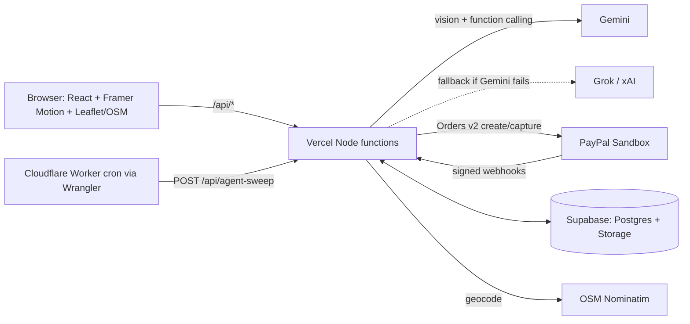

**Live Demo:** https://splitpilot-iota.vercel.app
# 🧾 SplitPilot

**An AI agent that turns a receipt photo into settled PayPal payments, and it can never spend money without a human approving it.**

Built for the *Build What's Next with PayPal and AI* hackathon.

> **Judges: 60-second try-out**
> 1. Open the hosted demo → click **Use sample receipt** → **Create split**.
> 2. In the agent chat, click the suggestion chip (or type *"Dinner was me, Asha, Ravi and Meera. Asha had the paneer tikka, Ravi and I shared the garlic bread, Meera had the gulab jamun. The masala soda is shared by all four of us"*).
> 3. Review the **proposed split**, click **Approve & create payment requests**.
> 4. Click a **Pay link**, pay with a PayPal *sandbox personal* account, and watch the first tab flip to **Paid** live.
>
> Hosted demo: `ADD-YOUR-VERCEL-URL` · Demo video: `ADD-YOUTUBE-URL`

---

## What it does

1. **Reads the receipt.** Upload a photo; Gemini extracts items, tax and tip as structured JSON, which the server validates.
2. **Understands plain language.** Tell the agent who had what. Gemini function-calling turns that into a *proposal*.
3. **Never does the math with the LLM.** The server computes every share in integer cents, so tax and tip are allocated exactly and the shares always add up to the bill (property-tested).
4. **Human-in-the-loop guardrail.** The agent can only *propose*. Payment requests are created when the owner clicks **Approve**. Per-person and per-bill caps are enforced server-side.
5. **Collects through PayPal.** Each friend gets a pay link (PayPal Orders v2 + Checkout buttons). Amounts always come from the database, never from the browser.
6. **Live status.** PayPal webhooks (signature-verified, idempotent) settle payments securely on the server, and the dashboard updates live via periodic API polling.
7. **Chases for you.** A Cloudflare Worker cron wakes an agent endpoint that drafts friendly reminders (shared via one-tap WhatsApp/copy; nothing is sent automatically).
8. **Trip ledger.** Every split is pinned on an OpenStreetMap.

## Architecture



## Tools used (and why)

| Tool | How it is used |
|---|---|
| **PayPal (Sandbox)** | Orders v2 create + capture, JS SDK Checkout buttons, signed webhooks (`PAYMENT.CAPTURE.*`), idempotent settlement |
| **Google Gemini** | Primary AI: receipt vision → structured JSON; agent function calling (`propose_split`, `draft_reminders`) |
| **Grok (xAI)** | Text-only fallback for the agent when Gemini errors or rate-limits (OpenAI-compatible API) |
| **Supabase** | Postgres + Row Level Security (all client access revoked), private Storage bucket for receipts |
| **Vercel** | Hosting + Node serverless API |
| **Wrangler / Cloudflare Workers** | Scheduled reminder sweeps (Vercel Hobby only allows daily crons) |
| **React + JavaScript + CSS** | Frontend (Vite), CSS variables, light/dark |
| **Framer Motion** | Approval-card, progress and status animations |
| **Lucide React** | Icons |
| **OpenStreetMap** | Leaflet map tiles, venue picker, trip ledger; Nominatim geocoding |
| **Node.js** | Runtime for the API and Wrangler |
| **Antigravity** | Development IDE (with the PayPal MCP server for API help) |

## Security & safety design

- **Propose → approve.** The model has no tool that moves money. The only path to payment requests is `POST /api/approve`, which atomically claims the proposal and re-validates it.
- **Server-side amounts & currencies.** `create-order` reads the share from the DB; `capture-order` and `paypal-webhook` verify captured amounts in integer cents and currency codes against the database.
- **Webhook hygiene.** Raw payload verification against PayPal's signature endpoint, correlation by PayPal order ID, idempotency table, safe acknowledgment of unresolvable events.
- **Prompt-injection posture.** Receipt text and chat are treated as data; model output is validated and bounded (names sanitized, links stripped from reminders, amounts recomputed).
- **Hardened RLS & Server-Only Database Access.** The browser has zero direct database or Realtime access; all tables have RLS enabled and privileges revoked from `anon`, `authenticated`, and `PUBLIC`. All queries run through authenticated server-side API endpoints using `service_role`. Owner secrets live in `split_secrets`. Receipt photos are stored in a private bucket with short-lived signed URLs.
- **Sandbox only.** No real money.

*Known hackathon trade-offs (documented honestly):* split data is readable by anyone holding a split's UUID link (demo data only, no emails or card data stored); there is no user login (owner access uses a secret key link); no rate limiting on AI endpoints. Production path: Supabase Auth with per-owner RLS, rate limits, and PayPal Payouts / multi-party payments for true peer-to-peer settlement (in the sandbox, payments settle into the app's Business account).

---

## Run it yourself

### 0. Prerequisites
Node 20+, accounts for: PayPal Developer, Supabase, Google AI Studio, Vercel (xAI and Cloudflare optional).

### 1. Install
```bash
npm install
npm test        # offline tests: split math, agent guardrails, LLM layer, payment security
```

### 2. Supabase
1. Create a project. **SQL Editor → paste `supabase/schema.sql` → Run** (safe to re-run).
2. Copy `Project URL` and `service_role` key (Project Settings → API). Set `SUPABASE_URL` and `SUPABASE_SERVICE_ROLE_KEY` in your server environment.

### 3. PayPal Sandbox
1. developer.paypal.com → **Apps & Credentials → Sandbox → Create App**. Copy Client ID + Secret.
2. **Sandbox → Accounts**: keep a *Business* (merchant) and a *Personal* (test buyer) account.

### 4. Gemini (and optional Grok)
1. aistudio.google.com → create an API key. Choose a current model from the model list and set `GEMINI_MODEL`. *(Model IDs change; if you get a "model not found" error, update this variable.)*
2. Optional: console.x.ai → API key → `XAI_API_KEY`, and set `XAI_MODEL` to a current Grok model id.

### 5. Environment variables
Copy `.env.example` → `.env` for local use, and add the **same values** in Vercel → Project → Settings → Environment Variables. Generate `CRON_SECRET` with `openssl rand -hex 24`.

### 6. Deploy to Vercel
Push to GitHub → import the repo in Vercel (framework: Vite, defaults are fine) → add env vars → deploy.
Local full-stack dev: `npm i -g vercel && vercel dev` (plain `npm run dev` has no `/api`).

### 7. PayPal webhook
PayPal Dashboard → your app → **Webhooks → Add webhook**:
- URL: `https://YOUR-APP.vercel.app/api/paypal-webhook`
- Events: `PAYMENT.CAPTURE.COMPLETED`, `PAYMENT.CAPTURE.DENIED`, `PAYMENT.CAPTURE.REFUNDED`
- Copy the **Webhook ID** into `PAYPAL_WEBHOOK_ID` in Vercel, then **redeploy**.

> The dashboard's "webhook simulator" events usually fail signature verification. Test with a real sandbox payment.

### 8. Reminder cron (Cloudflare Worker via Wrangler)
```bash
cd worker
# edit wrangler.toml -> SWEEP_URL = "https://YOUR-APP.vercel.app/api/agent-sweep"
npx wrangler login
npx wrangler secret put CRON_SECRET     # paste the SAME value as in Vercel
npx wrangler deploy
```
It runs every 15 minutes. Tune `SWEEP_MIN_AGE_MIN` / `SWEEP_INTERVAL_MIN` in Vercel. For a live demo, open the worker URL in a browser to trigger a sweep immediately (set `SWEEP_MIN_AGE_MIN=0` temporarily).

### 9. Smoke test
Sample receipt → agent → approve → pay with a sandbox Personal account → status flips to Paid.

## Troubleshooting

| Symptom | Fix |
|---|---|
| `/api/...` returns 404 locally | Use `vercel dev`, not `npm run dev` |
| Agent says AI is unavailable | Check `GEMINI_API_KEY` and `GEMINI_MODEL` (model may have been renamed/retired); see Vercel function logs |
| Receipt upload fails with 502 | Same as above; try the sample receipt to isolate it |
| Payment succeeds but status doesn't flip | Check the webhook URL, `PAYPAL_WEBHOOK_ID`, and that you redeployed after setting it; the client UI polls every 5s |
| PayPal button doesn't render | `VITE_PAYPAL_CLIENT_ID` must be set **before build**; redeploy after adding it |
| Map tiles missing | Ensure `leaflet/dist/leaflet.css` loads (it's imported in `src/main.jsx`) |

## Project layout
```
api/            Vercel serverless endpoints (receipt parsing, agent, approval, PayPal order/capture/webhook, sweep)
api/_lib/       LLM layer (Gemini + Grok fallback), agent tools & guardrails, exact split math, PayPal client
src/            React app (create flow, split dashboard, agent feed, pay page, maps)
supabase/       schema.sql (tables, RLS, storage bucket)
worker/         Cloudflare Worker (Wrangler) for scheduled reminders
scripts/        Offline tests
docs/           Devpost text, demo-video script, submission checklist
```

## License
MIT. See `LICENSE`.
